# Лабораторная работа № 1 — Собственный Docker

Статус: подготовка; эксперименты ещё не выполнены.

Задание: [Lab 1 — Your own Docker](../containerization-and-orchestration/lecture-1-docker/lab.md).
Теория: [Lecture 1](../containerization-and-orchestration/lecture-1-docker/README.md).

## Цель

Поэтапно изолировать обычный HTTP-процесс средствами Linux, ограничить ресурсы и привилегии, собрать запуск в `mydocker.sh` и сравнить результат с Docker и gVisor.

## Окружение удалённого устройства

Заполняется по фактическим данным: ОС, версия ядра, архитектура, доступные CPU и память, права пользователя, версия cgroups, версии инструментов.

## Порядок работы

Все команды выполняются пользователем на удалённом устройстве. Для каждого этапа ниже сохраняются команды, фактические результаты, объяснение механизма и выводы. Скриншоты размещаются в `screenshots/` и встраиваются относительными ссылками вида ``.

## Часть 0. HTTP-сервис

Подготовлен вспомогательный сервис на Go: [main.go](main.go). Он использует только стандартную библиотеку, не требует внешних зависимостей. Контракт зафиксирован в [api/openapi.yaml](api/openapi.yaml).

| Запрос | Поведение и ответ |
|---|---|
| `GET /health` | HTTP 200, текст `ok` без перевода строки. |
| `GET /eat?mb=N` | Дополнительно выделяет N MiB (1 MiB = 1 048 576 байт), записывает каждый байт и удерживает память до завершения процесса. HTTP 200: `allocated N MiB; retained T MiB` с переводом строки; T — суммарный объём удерживаемых блоков. |
| `GET /burn` | Запускает один бесконечный вычислительный цикл в фоновой goroutine. HTTP 200: `burning` с переводом строки. Повторные запросы не добавляют CPU workers. |

Порт по умолчанию — `8080`, слушаются все интерфейсы; его можно изменить переменной `PORT` (целое число 1–65535). При запуске в лог выводится PID процесса.

Для `mb` принимается ровно одно положительное десятичное число из цифр. Отсутствующее, повторяющееся, нулевое, некорректное или выходящее за диапазон адресуемого размера значение возвращает HTTP 400. При повторных запросах память накапливается; ограничение cgroup сервис самостоятельно не обходит и не заменяет собственным малым лимитом. При нехватке памяти процесс может завершиться до HTTP-ответа. RSS включает также память Go runtime и не обязан совпадать с суммой N.

CPU-нагрузка расходует до одного логического CPU суммарно, но может перемещаться между ядрами: affinity не закрепляется. HTTP-обработчики продолжают работать параллельно с нагрузкой, с задержками, зависящими от планировщика и CPU-лимита. Память и CPU-нагрузка сбрасываются перезапуском процесса.

Статус: исходники подготовлены; сборка, запуск и проверка endpoint на удалённом устройстве ещё не выполнялись.

## Часть 1. Запуск без изоляции

### Запустил процесс: 

### Ответ в браузере:

### ps тоже показывает пид процесса:

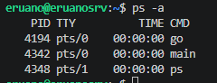

## Часть 2. Namespaces

Предстоит описать изоляцию pid, mount, net, uts, ipc и user; показать PID 1 внутри, PID и UID на хосте, hostname и сетевое окружение.

### Эффект unshare:

### Запустил сервер:
Видно, что теперь сервер считает, что у него пид 1

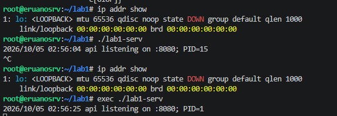

### Как выглядит ситуация на хосте под тем же пользователем:

При запущенном сервере можем зная пид сделать запрос на сервер:

## Часть 3. Cgroup v2

Установил лимиты:

Запустил сервер:

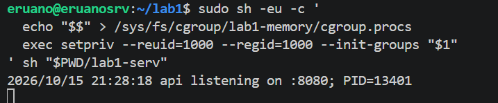

Проверил лимиты:

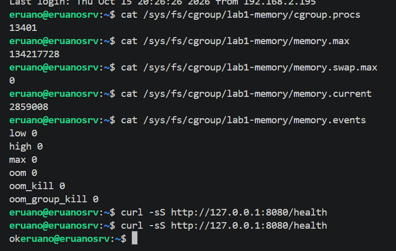

Попытался забрать больше памяти чем положено, оом сработал:

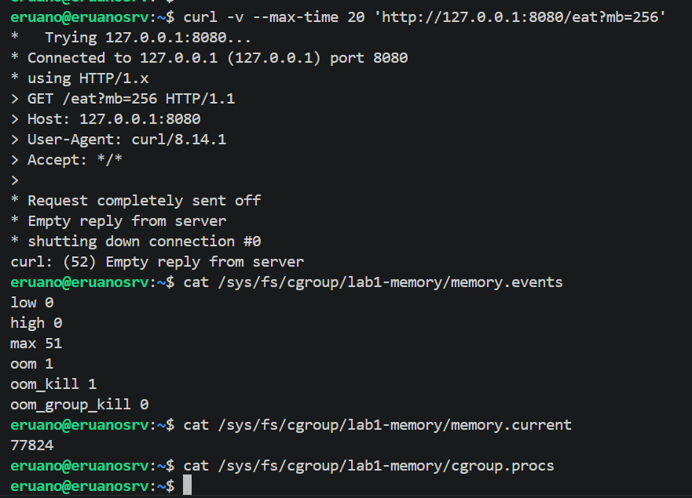

Приложение завершилось:

### CPU

Ограничения задал:

Сервис тротлит, что видно по статистике, но продолжает отвечать:

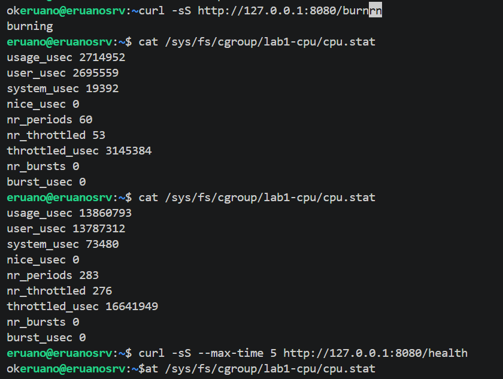

### Proc:

Создали сгруп и проверил настройки

Запустил стресс-тест

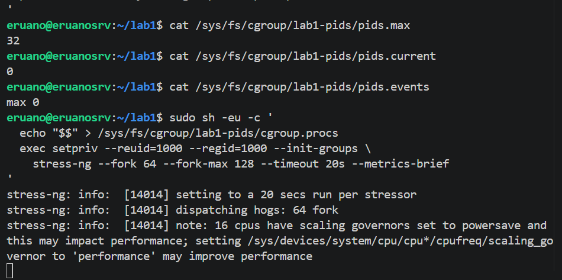

Увидел увеличение счётчика:

## Часть 4. Привилегии

Ограничил возможности пользователя в изолированном пространстве:

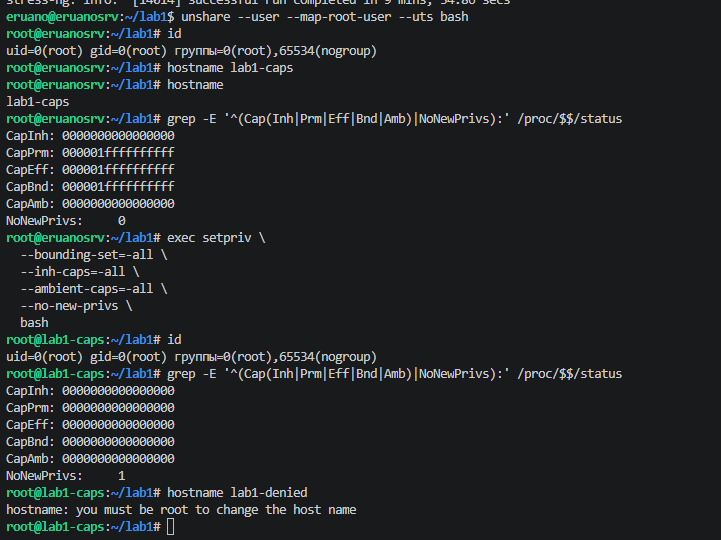

С хоста достаём до сервера при том, что доступы на предыдущем скрине отобрали:

### seccomp

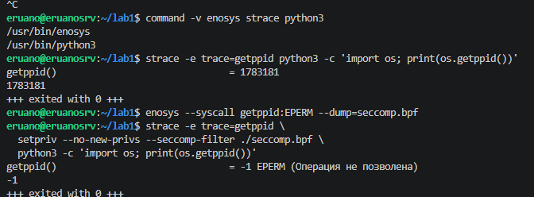

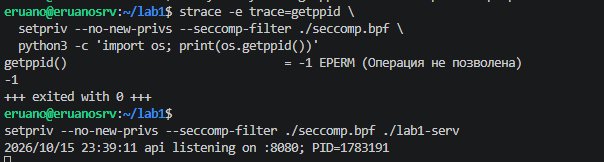

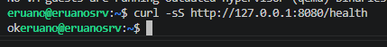

## Часть 5. Собственный запуск и сравнение с Docker

Подготовлен [mydocker.sh](mydocker.sh), объединяющий namespaces, cgroup v2, удаление capabilities и загрузку seccomp. [Согласованный контракт и команды проверки](mydocker-spec.md).

Лимиты: память 128 MiB, swap 0, CPU 0,5, число задач 64. Внутри сервиса PID 1, на хосте — UID вызывающего пользователя. HTTP доступен через вход в network namespace; корневая файловая система остаётся хостовой. Управляющий процесс находится вне cgroup и очищает её при завершении.

Проверено пользователем на удалённом Debian 2026-10-16: `bash -n mydocker.sh` прошёл без ошибок; управляющий PID — `1783284`, PID сервиса на хосте — `1783296`, внутри — `1`, UID на хосте — `1000`. Скрипт вывел `Самопроверка запуска: OK`, запрос `/health` через `nsenter --net` вернул `ok`. После Ctrl+C отсутствие `/sys/fs/cgroup/lab1-1000-1783284` подтверждено сообщением `cgroup удалена`.

Docker на сервере проверен: Client/Engine `26.1.5+dfsg1`, containerd `1.7.24`, runc `1.1.15`; cgroup v2, драйвер `systemd`; SecurityOptions: AppArmor, встроенный seccomp, cgroupns. [Команды сравнения с Docker](part5-docker.md). Пользователь подтвердил запуск `lab1-docker`: `/health` через `127.0.0.1:8081` вернул `ok`; PID на хосте `1783516`, внутри — `1`; UID `1000`; `CapEff=0`, `NoNewPrivs=1`, `Seccomp=2`. Отображение UID прямое: `0 0 4294967295`. Фактические файлы cgroup показали `memory.max=134217728`, `memory.swap.max=0`, `cpu.max=50000 100000`, `pids.max=64`. После `docker stop lab1-docker` контейнер исчез из `docker ps -a`, как и ожидается при `--rm`.

| Механизм | mydocker.sh | Проверенный запуск Docker |
|---|---|---|
| PID сервиса внутри | 1 | 1 |
| Лимиты ресурсов | 128 MiB, swap 0, 0,5 CPU, 64 задачи | Те же значения в cgroup |
| Пользователь | UID 0 внутри отображён в UID 1000 хоста | UID 1000 внутри и на хосте; `--user` не создаёт отображление UID |
| Capabilities / no_new_privs | Cap-наборы обнулены, no_new_privs=1 | CapEff=0, no_new_privs=1 |
| Seccomp | Учебный BPF-профиль, запрещающий getppid с EPERM | Встроенный профиль Docker; режим filter подтверждён, правила отличаются |
| Сеть | Отдельный loopback; обращение через nsenter | Bridge и публикация порта 8081 хоста на 8080 контейнера |
| Корневая файловая система | Файлы хоста, отдельного rootfs нет | Образ Debian, бинарник подключён read-only bind mount |
| Очистка | Trap и cgroup.kill; удаление группы после Ctrl+C подтверждено | Управление через daemon/runtime; удаление контейнера после stop с --rm подтверждено |

Вывод: базовую изоляцию и лимиты обеспечивают одни и те же механизмы ядра. Docker дополнительно организует rootfs из образа, сеть и публикацию портов, управление жизненным циклом и логами. Bridge сам по себе не публикует порт: для запроса на порт 8081 хоста нужна отдельная настройка публикации. Отдельные проверки SIGTERM и OOM именно для объединённого скрипта пока не проводились.

Запустил:

Проверка работает:

Запустил докер:

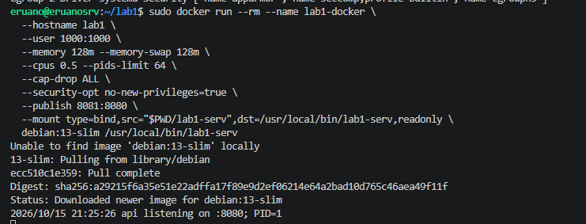

Проверил лимиты настройки, айдишники:

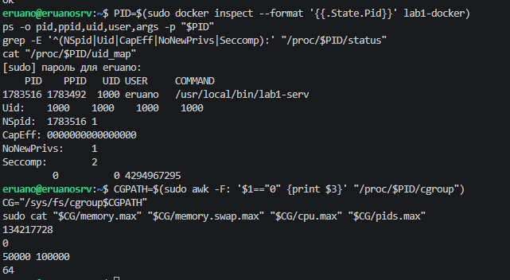

Завершил контейнер:

## Часть 6. Образы и хранение данных

Подготовлены [обычный Dockerfile](Dockerfile.single), [multi-stage Dockerfile](Dockerfile), [go.mod](go.mod) и [.dockerignore](.dockerignore) по [согласованному контракту](images-spec.md). [План выполнения](part6-plan.md); [команды первого этапа](part6-images.md).

Обе сборки используют Go 1.24.4, одинаковые исходники и статическую компиляцию с CGO_ENABLED=0. Обычный образ сохраняет toolchain, конечная стадия multi-stage основана на scratch и содержит только бинарник. Оба образа запускают сервис от UID/GID 1000:1000 на порту 8080.

Статус: сборки, HTTP-проверки, измерение размеров/слоёв и кэш ещё не подтверждены. Файловые эксперименты с writable layer и volume выполняются после проверки образов. Фактические значения и скриншоты будут добавлены по результатам пользователя.

## Часть 7. GVisor и границы изоляции

Предстоит выполнить запуск через `runsc`, сравнить его с Docker и собственным скриптом, объяснить роль общего ядра и дополнительную границу gVisor.

## Часть 8. Мониторинг

Предстоит подготовить дашборд памяти, CPU и throttling; выбрать три метрики для алертов и обосновать, какие проблемы они обнаруживают.

## Материалы для защиты

- Код сервиса и Dockerfile.
- `mydocker.sh` и профиль seccomp.
- `README.md` с описанием и выводами.
- Скриншоты: PID внутри и снаружи; OOM; throttling; отказы seccomp/capabilities; работа `mydocker.sh`; сравнение размеров образов; дашборд.
- Итоговые выводы заполняются после выполнения экспериментов.
